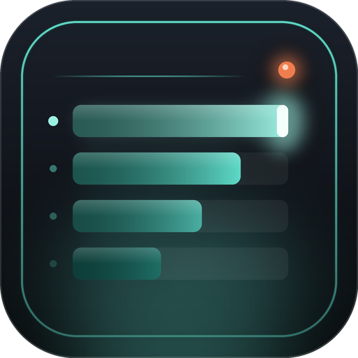

<p align="center">
  
</p>

# Aethermeter

**A damage and healing meter that lives inside the game.**

A combat meter for Final Fantasy XIV built on [Dalamud](https://github.com/goatcorp/Dalamud), in the spirit of World of Warcraft's Details!. No external parser to start and nothing to attach: the numbers are read straight from the combat results your client already receives, and drawn in game.

[](https://www.patreon.com/GitHixy)
[](https://discord.gg/9kjUjWDBkJ)


[](LICENSE)

---

## What it does

| View | Shows |
| --- | --- |
| **DPS / Damage Done** | Damage per second and total, with each player's share of the group |
| **HPS / Healing Done** | Effective healing per second and total |
| **Damage Taken** | Who soaked what, and from which ability |
| **Overhealing** | Healing that landed on a full bar (estimated) |
| **Deaths** | Who died, how often, and to what |

- **Segments.** Every pull is its own segment, plus an Overall segment across all of them. Pick any past pull from the header.
- **Breakdowns.** Click a bar for that player's abilities (hits, crit and direct-hit rates, average and biggest hit), damage taken, a DPS/HPS graph, and a recap of the seconds before each death.
- **Several windows.** Open as many meters as you like, each on its own view; lock them, or let clicks pass through to the game.
- **Streamer mode.** Show other players by job ("Dragoon 2"), job abbreviation or initials, everywhere: bars, tooltips, breakdowns, death recaps, copied summaries and saved files.
- **Your look.** Four bar styles, job, role or single-colour bars, fonts and sizes for names, numbers and header, opacity, spacing and rounding.
- **Pets and allies.** Summons and pets count toward their owner; Trust and Duty Support allies show up as party members.
- **Chocobos.** A chocobo companion is a combatant of its own, shown as "Bocchan (Kael Highwind)" in chocobo yellow, with the same chocobo icon the party list uses. In streamer mode its name becomes "Company Chocobo" and its rider is hidden like everyone else.

## Logs for FFLogs

Aethermeter can write the fight as an ACT network log, the format FFLogs reads, and you upload it with the [Archon App](https://www.fflogs.com/client/download) (FFLogs' uploader). No ACT needed.

- **Live log.** Switch it on with the record dot on the meter's header, `/meter log`, or Settings → Logs. It can run everywhere or only while you're in a duty. Point the Archon App's live logging at the log folder.
- **Single pulls.** The current zone's log is kept in memory, so any pull can be saved as its own small file from the meter's menu ("Save pull log for FFLogs"), or every pull automatically.
- **Your folder.** Pick any folder, use the default (`Documents\Aethermeter\FFXIVLogs`), or ACT's folder, which is where the Archon App looks first. Files are named `*_Aethermeter.log`, so they never mix with ACT's.
- **Auto-clean.** Delete Aethermeter's logs older than 1 week, 2 weeks, 1 month or 3 months, on load and every six hours (and saved segment files too, if you like). ACT's own logs are never touched.

What goes in: abilities and their raw effects (21/22), DoT/HoT ticks (24), director updates such as pull start, wipe and clear (33), combatants (03/04), statuses (26/30), casts (20/23), deaths (25), zone, player, party and stats (01/02/11/12), and combat state (260).

> The log follows ACT's documented line format, but hasn't been confirmed against every FFLogs parser version yet. If an upload fails, please report it on Discord.

## Commands

| Command | Does |
| --- | --- |
| `/meter` | Show or hide the meter windows |
| `/meter config` | Open settings |
| `/meter reset` | Clear every segment |
| `/meter lock` · `/meter unlock` | Lock or unlock every window |
| `/meter new` | Add a meter window |
| `/meter test` | Play a made-up fight to preview the meter |
| `/meter log` | Start or stop the live log for FFLogs |
| `/meter news` | Show what's new |

## How it works

Aethermeter hooks two game functions, both located through [FFXIVClientStructs](https://github.com/aers/FFXIVClientStructs) rather than private signatures:

- `ActionEffectHandler.Receive` — every action's damage, heals and misses, on every target.
- `StatusManager.ProcessHotDot` — DoT and HoT ticks.

Both are read-only taps: the game's own code always runs. Names, icons and jobs come from the game's sheets, so they follow your client language and new jobs and actions work without an update.

### DoT and HoT ticks

The server leaves the status out of ordinary ticks, and may send one combined tick for every DoT on a target. Aethermeter settles the ticks of each server tick together, per target:

1. Ticks that name a status (ground effects such as Salted Earth, Doton or Asylum) go to their source — or the source's owner, when the source is the ground effect's own actor. With no source, the status on the target, or on the caster for caster-side effects, names one.
2. When every player with a DoT on the target sent their own tick, each tick is credited to them exactly.
3. Otherwise the total is shared among the DoTs on the target by each one's per-tick value, learned from the exact cases during the fight.

Totals always match what the server sent; only the split of a combined tick is an estimate, as it is for ACT and FFLogs.

### Shields

Shields count as healing by their caster, for the damage they actually absorbed. The client keeps one shield gauge per character (a whole percent of max HP) plus the shield statuses, so Aethermeter reads both each frame: the gauge rising as a shield appears is that shield's size; the gauge dropping right after damage is damage absorbed, taken from the oldest shield first; a drop with no damage is a shield wearing off. Shield statuses are recognised from their description, and any other status that raises the gauge is learned on the spot.

### Known limits

- Overhealing is estimated from the target's HP when a heal lands, so it can differ a little from FFLogs.
- Each shield is accurate to about 1% of the target's max HP, the gauge's resolution.

## Privacy

Aethermeter never posts to chat and never sends anything anywhere. Saved segments go to the plugin's own config folder.

## Building

```
dotnet build -c Release
```

Then copy `bin/Release/Aethermeter.dll`, `Aethermeter.json`, `Aethermeter.deps.json` and the `Assets` folder into a dev plugin folder and add it under `/xlsettings` → Experimental.

## Community

Questions, ideas, or a parse to show off? Join the [Discord](https://discord.gg/9kjUjWDBkJ): it's also where new versions are announced first. If you enjoy Aethermeter, you can support its development on [Patreon](https://www.patreon.com/GitHixy).

[](https://discord.gg/9kjUjWDBkJ)
[](https://www.patreon.com/GitHixy)

## Credits

Fonts: Barlow, Barlow Condensed and Bebas Neue, under the SIL Open Font License (see `Assets/Fonts/licenses`).
